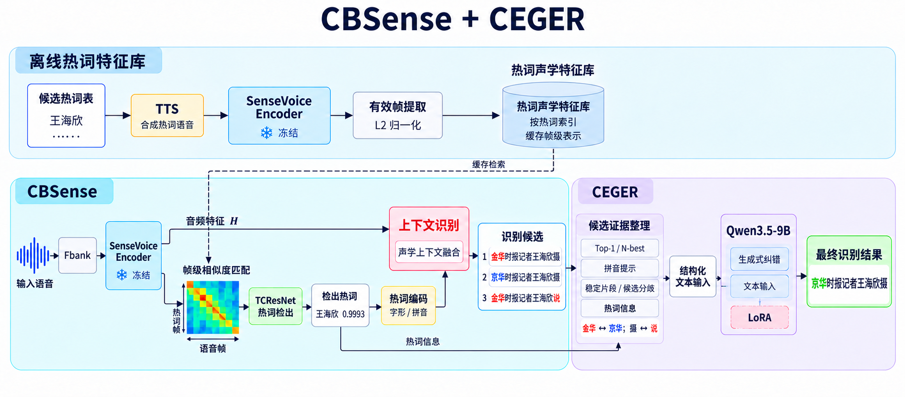
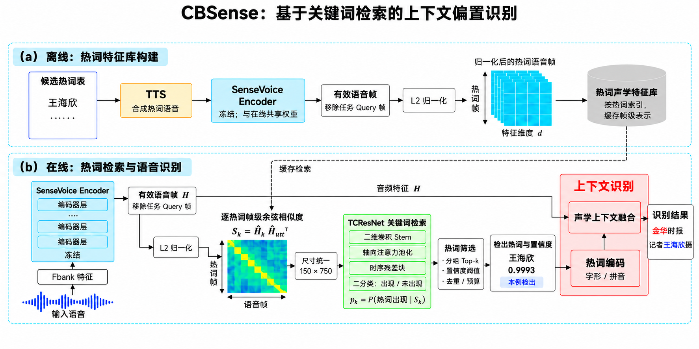
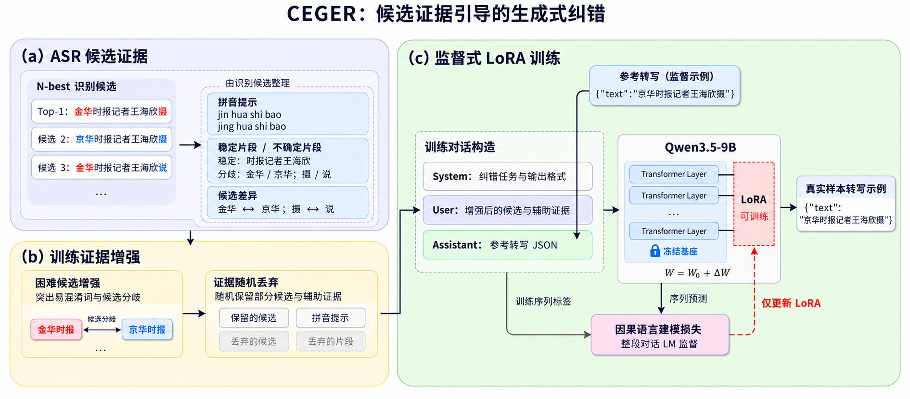
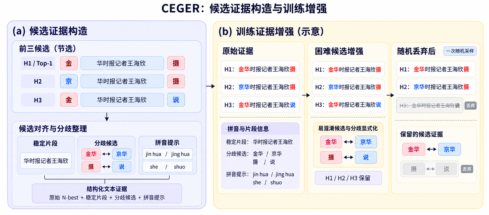

<h1 align="center">CBSense · CEGER</h1>

<p align="center">
  <strong>Contextual ASR + Candidate-Evidence-guided Generative Error Correction</strong><br />
  <sub>面向热词与专名的上下文语音识别及候选证据引导纠错</sub><br />
  <sub>Context-aware speech recognition and evidence-guided transcript correction</sub>
</p>

<p align="center">
  <a href="https://github.com/sagune/covo/actions/workflows/test.yml"></a>
  
  
  
</p>

<p align="center">
  <a href="#中文">中文</a> &nbsp;|&nbsp;
  <a href="#english">English</a> &nbsp;|&nbsp;
  <a href="#快速开始">快速开始</a> &nbsp;|&nbsp;
  <a href="#实验结果">实验结果</a> &nbsp;|&nbsp;
  <a href="#quick-start">Quick Start</a>
</p>

> [!IMPORTANT]
> 当前主链路是 **CBSense → 文本证据整理 → CEGER**。完整工程位于 [`server_snapshot/`](server_snapshot/)；根目录的早期 CoVo 工具保留作历史版本。模型权重和数据集需另行准备。
>
> The current pipeline uses one text-only 9B correction model. Full-system sources are archived under `server_snapshot/`; weights and datasets are not bundled.

<p align="center">
  
</p>

---

# 中文

## 项目简介

CBSense · CEGER 面向中文语音中的人名、地名、专业术语及其他上下文热词，将热词识别与大模型转写纠错组织成一条可追踪的处理流程。

- **CBSense**：基于 SenseVoice 的上下文偏置识别模块，通过热词声学特征匹配和 TCResNet 检出相关热词，将上下文信息用于语音识别。
- **CEGER**：候选证据引导的生成式纠错模块，使用 Qwen3.5-9B + LoRA，联合读取识别候选、拼音与候选分歧等文本证据，生成最终转写。

CEGER 是原 CoVo 大模型模块的新名称；仓库名和 Python 包名仍为 `covo`。当前发布包含源码、锁定实验协议、历史报告及论文流程图。

### 我们研究什么问题

| 问题 | 系统中的设计 |
|---|---|
| 低频专名和热词容易识别成常见词 | 利用 TTS 构建热词声学特征库，并在输入语音中检索相关热词 |
| 大量候选热词会带来上下文干扰 | 先进行 KWS 检出与筛选，再将选出的热词用于上下文识别 |
| 单一 Top-1 隐藏了识别过程中的其他可能 | 将 N-best、拼音和候选分歧整理为结构化文本证据 |
| 纠错模型需要适应 ASR 的错误分布 | 使用候选证据增强与 LoRA 监督训练进行任务适配 |
| 总体 CER 可能掩盖专名丢失和过度改写 | 分别记录热词召回、正确输入误改及不同错误类型 |

这些是设计目标和评估问题，不代表每个实验都已经实现无代价改善。

## 核心特色

<table>
<tr>
<td width="50%" valign="top">
<h3>热词声学检索</h3>
<p>通过合成语音与冻结的 SenseVoice 编码器构建帧级热词表示。在线语音与特征库匹配，TCResNet 判断候选热词是否出现。</p>
</td>
<td width="50%" valign="top">
<h3>上下文偏置识别</h3>
<p>将筛选后的热词编码与音频特征一起用于上下文识别，产生 Top-1 和 N-best，供后续纠错使用。</p>
</td>
</tr>
<tr>
<td width="50%" valign="top">
<h3>多候选证据引导</h3>
<p>保留候选之间的一致与分歧，结合拼音线索及适用的热词信息，组织成可读取的纠错输入。</p>
</td>
<td width="50%" valign="top">
<h3>LoRA 任务适配</h3>
<p>冻结大模型基座，训练低秩适配参数。基础阶段引入困难候选增强和证据随机丢弃，以适应识别错误与不完整候选。</p>
</td>
</tr>
</table>

## 系统架构

| 阶段 | 主要处理 | 产物 |
|---|---|---|
| 离线准备 | 热词 → TTS → SenseVoice → 有效帧提取与归一化 | 热词声学特征库 |
| 在线检索 | 输入音频特征与热词库匹配 → TCResNet 检出与筛选 | 检出热词及其分数 |
| 上下文识别 | 音频特征 + 热词编码 | Top-1 / N-best |
| 证据整理 | 候选、拼音、稳定/分歧片段、适用的热词信息 | 结构化文本输入 |
| 生成式纠错 | Qwen3.5-9B + 已训练 LoRA | 最终转写 JSON |

CEGER 不直接接收波形或音频张量。连接器、声学匹配和后续 A/B 复核属于单独的探索实验，未混入上方主流程。

<details>
<summary>展开 CBSense 模块图</summary>



</details>

### 一个真实候选示例

| 位置 | 内容 |
|---|---|
| CBSense Top-1 | 金华时报记者王海欣摄 |
| 候选 2 | 京华时报记者王海欣摄 |
| 候选 3 | 金华时报记者王海欣说 |
| 检出热词 | 王海欣 |
| 历史 9B 输出 | 京华时报记者王海欣摄 |

这是已有验证结果中的说明样本，不表示用于训练，也不代表整体性能。[样本来源与图示边界](docs/figures/SAMPLE_PROVENANCE.md)。

## 训练模式

第一轮基础 LoRA 沿用早期 4B 的数据构造思路，为 9B 独立加载基座并训练，不转移 4B 模型权重。

| 项目 | 第一轮 9B 基础训练 |
|---|---|
| 输入 | ASR 候选、拼音、稳定片段与候选分歧 |
| 数据增强 | 困难候选增强；随机丢弃部分候选与辅助证据 |
| 监督 | 参考转写进入训练目标，不作为推理输入 |
| 历史损失实现 | 整段训练对话的因果语言建模监督 |
| 参数更新 | 冻结 Qwen3.5-9B 基座，只更新 LoRA |

后续 CBSense 输入适配和声学研究分支使用不同的初始化、接口与训练目标，需分别阅读对应协议；不能用后续 Assistant-only loss 描述第一轮训练。

<details>
<summary>展开第一轮 LoRA 与候选证据图</summary>





</details>

## 实验结果

以下为同一份历史 **AISHELL contextual dev** 的诊断结果：1,334 句、21,102 参考字、599 个热词 mentions。它不是官方完整 dev，也不是新的独立测试集。

| 系统 / 条件 | 字符错误数 ↓ | CER ↓ | 热词召回 ↑ |
|---|---:|---:|---:|
| CBSense 输入 | 804 | 3.8101% | 90.15% |
| 原 checkpoint30022，D/text | 663 | 3.1419% | 77.80% |
| 联合训练后关闭音频，B/text | 622 | 2.9476% | 78.30% |

来源：[联合训练完整报告（已归档）](docs/archive/connectors/joint-lora-20260923.md)。B/text 来自联合训练后的文本推理条件，不是独立纯文本训练组。该表展示了当前的重要权衡：整体 CER 降低，但热词召回仍低于前端输入。

声学证据判决、三种子复验与全类型候选 Oracle 在[实验索引](docs/results/README.md)中单独报告。Oracle 是使用参考选择候选的理论上限，不能作为模型实测成绩。

早期 AISHELL、MAGICDATA-READ、ST-CMDS、THCHS-30 与 LibriSpeech 结果见[五数据集历史汇总](server_snapshot/RESULTS_ALL_DATASETS_20260826.md)。各报告的划分、热词来源和模型条件不同，不能直接混合排名。历史 **2.777% 属于 4B**，不是上述 9B 条件的统一基线。

## 快速开始

### 环境与资源

- 轻量数据工具的包元数据要求 Python `3.9+`；下面的完整源码轻量检查推荐 Python `3.11`，与 CI 一致。GPU 实验需匹配各协议的 Python、PyTorch、CUDA 与模型后端版本。
- 浏览文档、语法检查和后端轻量测试不需要 GPU。
- 端到端识别与 9B 推理需自行准备 SenseVoice、TCResNet、上下文适配器、9B 基座、匹配的 LoRA 和热词特征库。
- 历史配置保留原机器的路径与数据设置，使用前请阅读[快照说明](docs/current_snapshot.md)。

### 1. 获取源码与运行轻量检查

```bash
git clone https://github.com/sagune/covo.git
cd covo
python3 -m venv .venv
source .venv/bin/activate
python -m pip install -r requirements.txt

python scripts/check_source_snapshot.py
PYTHONPATH=src python -m unittest discover -s tests
```

### 2. 准备完整系统环境

在适配 CUDA 的独立环境中，从 `server_snapshot` 安装：

```bash
cd server_snapshot
python -m pip install -r requirements.txt
python -m pip install -e covo
python -m pip install -r covo/requirements-train.txt

PYTHONPATH=covo/src python covo/scripts/train_lora_sft.py --help
PYTHONPATH=covo/src python covo/scripts/infer_lora_text.py --help
```

前端模型位于 [`src/model/cb_sensevoice.py`](server_snapshot/src/model/cb_sensevoice.py)，CLI 与配置位于 [`src/run_CLI.py`](server_snapshot/src/run_CLI.py) 和 [`src/configs/`](server_snapshot/src/configs/)。文本证据转换入口为 [`cbsensevoice_covo_bridge.py`](server_snapshot/src/analysis/cbsensevoice_covo_bridge.py)。

> [!CAUTION]
> 部分历史配置是参考词表或错误定向的 Oracle 诊断，不能作为无泄漏主结果直接运行。先选择实验协议，再准备路径、热词来源与匹配检查点。依赖列表给出范围约束，不能替代特定实验的版本锁定。

### 3. 使用已准备好的文本证据推理

下面仅展示后端调用方式，不会从音频自动生成输入；路径需替换为自己的资源，提示格式需匹配 LoRA。

```bash
# 在 server_snapshot 中执行
python covo/scripts/infer_lora_text.py \
  --input /path/to/messages.jsonl \
  --output outputs/demo/predictions.jsonl \
  --model-name-or-path /path/to/Qwen3.5-9B \
  --adapter-path /path/to/matching-lora \
  --batch-size 1 \
  --disable-thinking
```

## 验证

```bash
# 从仓库根目录执行
python scripts/check_source_snapshot.py
PYTHONPATH=src python -m unittest discover -s tests

cd server_snapshot
PYTHONPATH=covo/src python -m unittest discover -s covo/tests

cd cbwhisper_covo_migration_20260609_tar_extracted/covo
PYTHONPATH=src python -m unittest discover -s tests
```

2026-10-14 发布检查：773 个服务器文件哈希一致；旧后端、快照后端、迁移运行时各 **19 项测试通过**；GitHub Actions 通过。三套测试存在重叠，不应视为 57 项独立功能。[发布检查记录](docs/PUBLICATION_AUDIT_20261014.md)。

轻量测试不代表已完成 GPU 数值检查、完整 CER 复算或端到端测速。ASR 正式验证仍需固定数据、归一化、检查点和计分口径，并保留失败样本。

## 目录与文档

```text
covo/
├── server_snapshot/                 # 当前完整系统源码留痕
│   ├── src/model/                   # CBSense、上下文适配与 CTC
│   ├── src/efficient_kws/           # TCResNet/KWS
│   ├── src/analysis/                # 证据桥接、数据工具与分析
│   ├── src/experiments/             # 锁定研究实验
│   ├── covo/                       # 主工程 CoVo/CEGER 后端
│   ├── cbwhisper_covo_migration_20260609_tar_extracted/covo/
│   │                               # 迁移实验对应后端源码
│   └── SOURCE_MANIFEST.json         # 原始文件大小与 SHA256
├── docs/figures/                    # 全流程、模块与训练图
├── docs/results/                    # 历史报告及实验索引
├── src/ · scripts/ · tests/         # 保留的早期 CoVo 工具
└── .github/workflows/               # 轻量自动检查
```

- [源码快照与重现说明](docs/current_snapshot.md)
- [历次实验结果与限制](docs/results/README.md)
- [论文图与真实样本来源](docs/figures/README.md)
- [源码哈希清单](server_snapshot/SOURCE_MANIFEST.json)
- [原仓库 README](docs/legacy/README-before-20261014.md)

## 当前边界

本项目是科研原型与源码归档，不是零配置部署产品。模型权重、语音数据、训练输入、逐条预测、依赖 overlay 和服务器环境未随仓库公开。部分历史实验保留绝对路径，重现需要另行准备对应资源。

CER 改善、热词召回和正确文本保护需要同时评价。重复使用的开发集、参考构造的词表及 Oracle 结果均应明确标注；不能将其包装成独立测试集上的泛化能力。当前也没有规范的单条端到端 GPU 延迟结论。

---

# English

## Overview

CBSense · CEGER is a research pipeline for contextual speech recognition and transcript correction, with a focus on Mandarin names, specialized terminology and user-provided hotwords.

**CBSense** retrieves relevant hotwords using SenseVoice acoustic representations and TCResNet keyword spotting, then incorporates the selected context into recognition. **CEGER** uses a LoRA-adapted Qwen3.5-9B to correct transcripts from textual candidate evidence: Top-1, N-best, pinyin, candidate agreement/disagreement and applicable hotword information.

CEGER is the renamed CoVo module; the repository and Python package retain the name `covo`. The primary pipeline contains one text-only 9B model. Acoustic connectors and later review models are separate research experiments.

## Design Highlights

- **Acoustic hotword retrieval:** an offline feature bank built from synthesized hotwords and frozen SenseVoice representations.
- **Context-aware recognition:** retrieved hotwords are encoded and incorporated into the ASR stage.
- **Candidate-evidence correction:** multiple hypotheses and pronunciation cues are organized into structured textual input.
- **Parameter-efficient adaptation:** a frozen LLM backbone with trainable LoRA parameters; foundational training uses candidate augmentation and evidence dropout.
- **Traceable experiments:** source hashes, fixed protocols and result reports distinguish measured predictions from reference-based Oracle bounds.

## Quick Start

For documentation and lightweight checks, no GPU is needed:

```bash
git clone https://github.com/sagune/covo.git
cd covo
python3 -m venv .venv
source .venv/bin/activate
python -m pip install -r requirements.txt
python scripts/check_source_snapshot.py
PYTHONPATH=src python -m unittest discover -s tests
```

For the current full-system sources, work under `server_snapshot/`, install its requirements and `covo` package in an isolated GPU-compatible environment, and provide the matching models, adapters, data and hotword feature bank. See the [snapshot guide](docs/current_snapshot.md) and the [Chinese quick start](#快速开始) for entry points. Do not install multiple same-named `covo` packages into one environment without controlling import paths.

## Evaluation and Scope

The historical AISHELL contextual development protocol contains **1,334 utterances, 21,102 reference characters and 599 hotword mentions**. It is neither the official full development set nor a fresh held-out test set. In the recorded joint-training comparison, B/text achieves CER **2.9476%** and hotword recall **78.30%**, versus **3.8101% / 90.15%** for its CBSense input. Lower overall CER therefore does not imply better hotword retention.

B/text is a text-inference condition after joint training, not a separately trained text-only control. The historical **2.777%** result belongs to the earlier 4B model. Consult the [experiment index](docs/results/README.md) for checkpoints, controls, confidence intervals and limitations. Reference-selected Oracle results are upper-bound diagnostics, not deployed model performance.

This release archives source code and reports; it does not bundle weights, datasets, per-utterance predictions or runtime environments. Lightweight tests do not establish GPU numerical reproducibility or end-to-end latency.

## Acknowledgements and License

The front-end snapshot retains the original [BSD-3-Clause notice](server_snapshot/LICENSE.md) for the Priberam contextual-biasing code. Models, dependencies and datasets remain governed by their respective licenses.

README layout takes inspiration from [智塔 · FAROS](https://github.com/OpenNSWM-Lab/FAROS). The system description, experiment records and figures belong to this project; no affiliation is implied.
